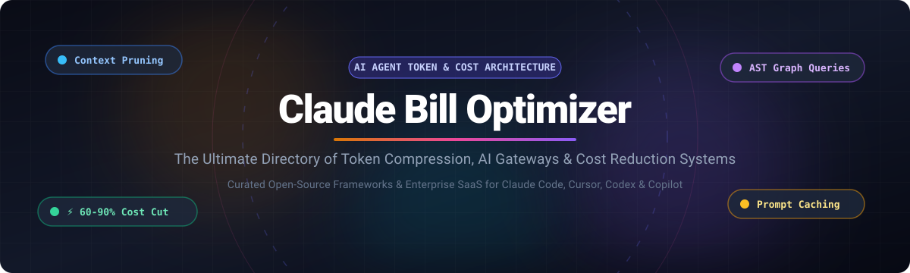

# 🚀 Awesome Claude Bill Optimizer [](https://github.com/ishandutta2007/Awesome-Awesome-Awesome)

<p align="center">
  
</p>

<p align="center">
  <a href="https://github.com/ishandutta2007/Awesome-Awesome-Awesome"></a><a href="https://discord.gg/jc4xtF58Ve"></a>
  <a href="https://github.com/ishandutta2007/Awesome-Claude-Bill-Optimizer/stargazers"></a>
  <a href="https://github.com/ishandutta2007/Awesome-Claude-Bill-Optimizer/network/members"></a>
  <a href="https://github.com/ishandutta2007/Awesome-Claude-Bill-Optimizer/issues"></a>
  <a href="https://github.com/ishandutta2007/Awesome-Claude-Bill-Optimizer/blob/main/LICENSE"></a>
  <a href="https://github.com/ishandutta2007"></a>
</p>

---

## ⚡ Overview & Ecosystem Focus

> **The definitive curated directory of SaaS platforms, enterprise AI gateways, and open-source tools to minimize LLM token burn, context bloat, and API expenses across Claude Code, Cursor, Codex, OpenCode, and AI coding agents.**

*Cutting Claude API bills and token consumption through output compression, prompt caching, AST graph navigation, semantic caching, and dynamic token-aware proxy bridges.*

---

## 📑 Table of Contents

- [🌐 Sector Overview & Market Dynamics](#-sector-overview--market-dynamics)
- [💼 SaaS & Hosted Platforms](#-saas--hosted-platforms)
- [🔓 Open-Source GitHub Projects](#-open-source-github-projects)
- [🛠️ Recommended Architecture & Multi-Layer Stack](#️-recommended-architecture--multi-layer-stack)
- [🤝 How to Contribute](#-how-to-contribute)
- [💖 Support](#-support)
- [📊 Star History](#-star-history)
- [⚠️ Disclaimer](#️-disclaimer)

---

## 🌐 Sector Overview & Market Dynamics

The **AI FinOps and LLM Cost Optimization** market represents a specialized, fast-growing slice of the broader **$3.2B–$6.2B LLMOps platforms sector**, expanding rapidly at an estimated **~26.7% CAGR toward $9B+ by 2035** as enterprise inference expenditure accelerates. 

The sector is currently **moderately-to-highly fragmented**: while hyperscalers and cloud platforms offer native observability, hundreds of specialized venture-backed startups and open-source projects solve distinct bottlenecks—ranging from wire-level prompt compressors and AST semantic indexers to intelligent fallback gateways and local bash compactors.

---

## 💼 SaaS & Hosted Platforms

| Platform | Starting Tier Price | Free Plan / Trial Limits | Company Scale (Valuation / Revenue) | Description |
| :--- | :--- | :--- | :--- | :--- |
| **[OpenRouter](https://openrouter.ai/)** | Pay-as-you-go + 5.5% deposit fee (starts at $5 minimum credit purchase) | **Free Forever**: 50 requests/day at 20 req/min on `:free` models (automatically upgrades to 1,000 requests/day once lifetime spend reaches $10) | **$7B–$7.5B Valuation** (Acquired by Stripe; $140M–$160M ARR) | Unified multi-provider inference gateway providing instant model routing, fallback resilience, and support for 200+ models. |
| **[MindStudio](https://www.mindstudio.ai/)** | **$20/month** (or $16/mo billed annually) + at-cost passthrough model usage | **Free Forever**: 1 active AI agent and up to 1,000 runs/month with bring-your-own-keys (BYOK) support | **$100M–$250M Valuation** (~$36M total venture funding raised; generating multi-million enterprise revenue) | Enterprise AI agent builder and model router allowing Claude Code to orchestrate agents programmatically with zero model markup. |
| **[Portkey](https://portkey.ai/)** | **$49/month** (Pro plan with enhanced governance & analytics) | **Free Forever**: 10,000 recorded log requests/month with universal API key management and prompt routing (logs stop recording when exceeded without blocking traffic) | **$140M Valuation** (Acquired by Palo Alto Networks; $18.1M venture funding raised) | Production AI gateway and LLMOps control plane featuring semantic caching, load balancing, virtual keys, and real-time budget guardrails. |
| **[Helicone](https://www.helicone.ai/)** | **$79/month** (Pro plan with unlimited seats & custom alerting) | **Free Forever**: 10,000 logged requests/month, 1 GB storage, 1 seat, and 7-day data retention | **~$25M–$50M Valuation** (Acquired by Mintlify; funded by Y Combinator) | Developer-first LLM observability proxy and caching layer that monitors token burn, detects cost anomalies, and caches repeated queries. |
| **[Headroom Labs Cloud](https://www.npmjs.com/package/headroom-ai)** | **Enterprise Custom Pricing** (in-VPC & dedicated support; OSS core is 100% free) | **14-day Enterprise Trial** (full features & VPC setup support) / Unlimited Free self-hosted OSS | **$25M–$50M Valuation** (~$14M funding raised from institutional VCs) | Context-compression layer and ML proxy for LLM agents that reduces message payload and log bloat before hitting Anthropic or OpenAI. |

---

## 🔓 Open-Source GitHub Projects

*Ranked strictly in descending order by GitHub_Stars.*

1. **[Graphify](https://github.com/Graphify-Labs/graphify)** [](https://github.com/Graphify-Labs/graphify/stargazers)  
   Turns an entire codebase, schema files, and documentation into a queryable, persistent knowledge graph using deterministic AST parsing. Delivers **up to 71.5x fewer tokens per query** compared to full-file reads without requiring external vector stores or LLM indexing keys. Supports TypeScript, JavaScript, Python, Go, Rust, Java, C#, and Ruby.

2. **[Caveman](https://github.com/JuliusBrussee/caveman)** [](https://github.com/JuliusBrussee/caveman/stargazers)  
   Lightweight skill and plugin for AI coding agents (Claude Code, Cursor, Codex) that compresses prose output to slash token expenditure by up to **65%**. Strips filler words and pleasantries while strictly preserving code blocks, error logs, and technical precision. Includes `/caveman-compress` for session memory compression and auto-clarity fallback guards.

3. **[RTK (Rust Token Killer)](https://github.com/rtk-ai/rtk)** [](https://github.com/rtk-ai/rtk/stargazers)  
   Ultra-fast CLI proxy and `PreToolUse` hook written in Rust that compacts shell command outputs (e.g., `git status`, test runs, directory trees) before they reach Claude's context window. Reduces consumption by **60–90%** without breaking prompt cache invariants. Built-in `rtk gain` dashboard provides real-time token tracking.

4. **[OmniRoute](https://github.com/diegosouzapw/OmniRoute)** [](https://github.com/diegosouzapw/OmniRoute/stargazers)  
   Self-hosted, local-first AI gateway that unifies 90+ providers and thousands of models behind a single OpenAI/Anthropic-compatible endpoint. Features auto-fallback routing on rate limits, quota tracking, zero telemetry, and built-in RTK/Caveman token compression integration.

5. **[Headroom](https://github.com/headroomlabs-ai/headroom)** [](https://github.com/headroomlabs-ai/headroom/stargazers)  
   One-function compression layer and local proxy for LLM context. Uses ML-based text compression, JSON array deduplication (SmartCrusher), and CacheAligner to shrink payloads prior to dispatching API calls to Anthropic or OpenAI.

6. **[LiteLLM](https://github.com/BerriAI/litellm)** [](https://github.com/BerriAI/litellm/stargazers)  
   Universal proxy server that interfaces 100+ LLMs with standard OpenAI/Anthropic schemas. Provides unified token spend tracking, virtual API keys, team-based budget caps, failover routing, and prompt caching to prevent accidental billing spikes.

7. **[Repomix](https://github.com/yamadashy/repomix)** [](https://github.com/yamadashy/repomix/stargazers)  
   Packs entire code repositories into clean, AI-optimized markdown/XML representations with built-in token counting, file exclusion filters, and compression switches to feed minimal context into AI coding assistants.

8. **[Portkey Gateway](https://github.com/Portkey-AI/gateway)** [](https://github.com/Portkey-AI/gateway/stargazers)  
   High-performance, ultra-fast AI gateway with automated retries, semantic caching, request timeouts, and load balancing across providers to dramatically reduce latency and redundant API invocations.

9. **[Bifrost](https://github.com/maximhq/bifrost)** [](https://github.com/maximhq/bifrost/stargazers)  
   Ultra-fast enterprise AI gateway built in Go by Maxim AI with microsecond overhead. Provides virtual keys, automatic model failover chains, adaptive load balancing, and budget governance for heavy LLM workloads.

10. **[code2prompt](https://github.com/mufeedvh/code2prompt)** [](https://github.com/mufeedvh/code2prompt/stargazers)  
    CLI utility that converts source trees into clean prompts formatted with token count awareness, templating support, and custom `.gitignore`-style filtering to trim irrelevant context.

11. **[LLMLingua](https://github.com/microsoft/LLMLingua)** [](https://github.com/microsoft/LLMLingua/stargazers)  
    Research-grade prompt compression algorithm from Microsoft. Leverages lightweight compact models to prune redundant and low-information tokens from long contexts, saving up to **20x tokens** while preserving downstream reasoning.

12. **[Helicone Gateway & OSS Core](https://github.com/Helicone/helicone)** [](https://github.com/Helicone/helicone/stargazers)  
    Open-source LLM observability, cost analytics, and proxy engine. Features exact-match and semantic caching, rate limiting, and comprehensive spend breakdown dashboards by user or task.

13. **[claude-token-efficient](https://github.com/drona23/claude-token-efficient)** [](https://github.com/drona23/claude-token-efficient/stargazers)  
    Drop-in `CLAUDE.md` instructions and configuration templates that direct Claude to keep replies terse and output token-conscious on intensive coding loops without altering source code.

14. **[Paritok](https://github.com/Paritok-official/paritok-4b-v1)** [](https://github.com/Paritok-official/paritok-4b-v1/stargazers)  
    Context compressor model and proxy that intercepts requests via `ANTHROPIC_BASE_URL` to compress prompts and prune tool schema overhead before forwarding upstream, returning intact responses with cache-aware cost statistics.

15. **[Token Savior](https://github.com/Mibayy/token-savior)** [](https://github.com/Mibayy/token-savior/stargazers)  
    MCP server that indexes repositories by AST symbols (functions, classes, call trees) so models navigate via pointers instead of reading entire raw files (**97% fewer chars injected**). Includes persistent SQLite WAL memory and bash output compaction.

16. **[Claude Token Optimizer](https://github.com/nadimtuhin/claude-token-optimizer)** [](https://github.com/nadimtuhin/claude-token-optimizer/stargazers)  
    Lightweight utilities and configurations specifically designed to monitor, budget, and reduce token usage for Claude API invocations and Claude Code sessions.

17. **[LeanCtx](https://github.com/jia-gao/leanctx)** [](https://github.com/jia-gao/leanctx/stargazers)  
    Drop-in prompt compression library for production LLM applications based on LLMLingua-2. Cuts token bills by 40–60% with zero code architectural changes.

18. **[Quicksilver](https://github.com/UditAkhourii/quicksilver)** [](https://github.com/UditAkhourii/quicksilver/stargazers)  
    Claude Code skill that delegates bulk judgment calls to lightweight local models, achieving up to 86% fewer Claude tokens on benchmarked multi-task evaluation suites.

---

## 🛠️ Recommended Architecture & Multi-Layer Stack

For production developer environments, maximum cost reduction is achieved by layering complimentary tools across the execution lifecycle:

```
[ Developer Terminal / Coding Agent ]
                 │
                 ▼
     [ 1. Wire & Output Filtering ]
     • RTK (Rust Token Killer) → Filters shell output (60-90% savings)
     • Token Savior → Symbol navigation instead of raw file dumping
                 │
                 ▼
     [ 2. Prompt & Graph Navigation ]
     • Graphify → Query codebase via deterministic AST knowledge graph
     • Caveman → Compresses agent prose output (20-65% savings)
                 │
                 ▼
     [ 3. Proxy & Caching Gateway ]
     • OmniRoute / LiteLLM / Portkey → Semantic caching & auto-failover
     • Anthropic Prompt Caching → 90% discount on cached input tokens
                 │
                 ▼
      [ Frontier Claude Models ]
```

---

## 🤝 How to Contribute

Contributions are welcome! Please follow these simple steps:

1. 🍴 **Fork the repository**
2. 🌿 **Create a new branch** (`git checkout -b feature/add-optimizer-tool`)
3. 📝 **Add your tool**: Maintain the tabular format for SaaS products or the Stars_Badge format for open-source repositories (sorted by stars descending).
4. 🚀 **Submit a Pull Request** with a concise description of your tool and benchmarks.

---

## 💖 Support

If you find this repository helpful in saving thousands of dollars on your AI bills, please consider:
- ⭐ **Starring this repository** to help others discover it
- 🍴 **Forking and sharing** it with your developer community
- ☕ **Buying a coffee & sponsoring ongoing maintenance**:  
  👉 **[Sponsor on GitHub](https://github.com/sponsors/ishandutta2007)**

---

## 📊 Star History

[](https://star-history.dera.page/#ishandutta2007/Awesome-Claude-Bill-Optimizer&type=date&legend=top-left)

---

## ⚠️ Disclaimer

- This is a community-curated list and does not constitute an endorsement.
- Token optimization and cost-cutting ratios vary depending on code structure, prompt design, and output length.
- Always benchmark tools on your own workflow to verify net token savings and prompt cache compatibility before deploying to production.
